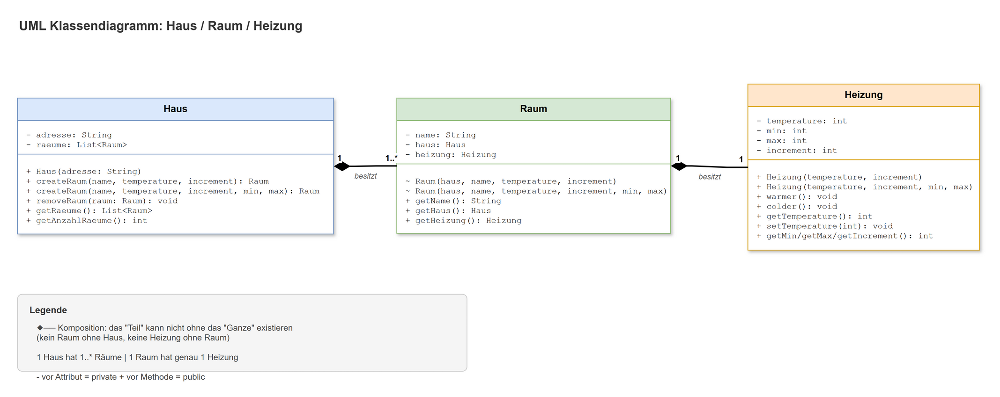

# D1 Erweiterung – Komposition Haus / Raum / Heizung

Erweiterung von [D1](../D1) (Klasse Heizung): Heizungen gehören jetzt zu Räumen, Räume zu einem Haus.

## Klassendiagramm (draw.io)



Quelle: [`klassendiagramm.drawio`](klassendiagramm.drawio)

## Komposition

Beide Beziehungen sind **Kompositionen** (ausgefüllte Raute beim *Ganzen*):

| Ganzes | Teil | Kardinalität | Umsetzung im Code |
|---|---|---|---|
| `Haus` | `Raum` | 1 Haus hat 1..* Räume | Nur `Haus.createRaum(...)` erzeugt Räume; die `Raum`-Konstruktoren sind package-private (`~`). |
| `Raum` | `Heizung` | 1 Raum hat genau 1 Heizung | Der `Raum` erzeugt seine `Heizung` im eigenen Konstruktor; sie wird nicht von aussen übergeben. |

Unterschied zur **Aggregation** (leere Raute, z. B. [D2](../D2) Flug ↔ Passagier): Bei der Aggregation existiert
das Teil auch ohne das Ganze. Ein Passagier gibt es auch ohne Flug, ein Raum ohne Haus dagegen nicht.

## Klassen

- `Heizung`: wie in D1 (Temperatur mit `min`/`max`, `warmer()`, `colder()` mit Warnung an der Grenze).
- `Raum`: Name, zugehöriges `Haus`, genau eine `Heizung`.
- `Haus`: Adresse und Liste der Räume; `createRaum(...)` (mit Standard- oder eigenem Temperaturbereich), `removeRaum(...)`.
- `HeizungTest`: interaktiver Test mit drei Räumen. `+` / `-` = aktive Heizung wärmer / kälter,
  `1` / `2` / `3` = Raum wechseln, `q` = beenden.

## Ausführen

```bash
javac -d out src/*.java
java -cp out HeizungTest
```
