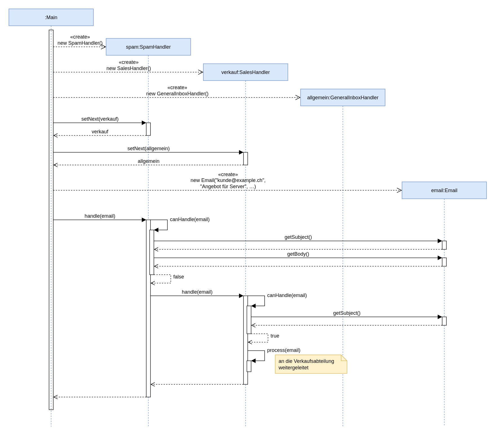
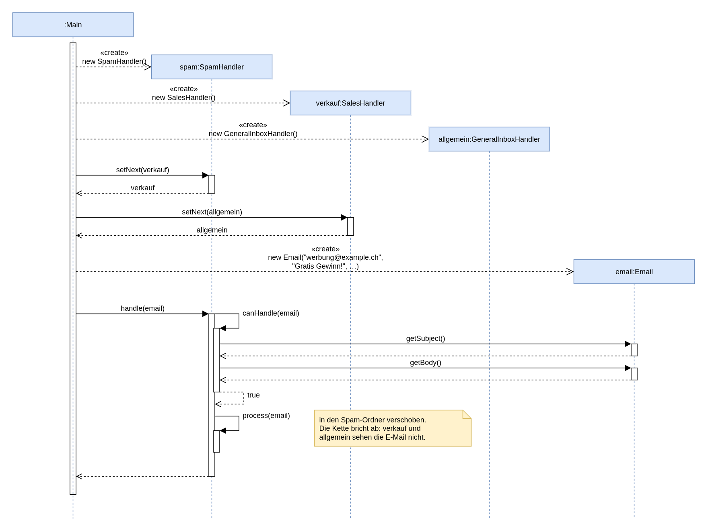

# Chain of Responsibility – E-Mail-Handler (M2 Serie A)

Java-Konsolenanwendung ohne externe Bibliotheken.

```bash
javac -d out src/*.java
java -cp out Main
```

## Klassen

- `AbstractEmailHandler`: Basisklasse mit `setNext(...)` und `handle(Email)`. `handle` prüft `canHandle`, verarbeitet bei Zuständigkeit mit `process` und gibt sonst an `next` weiter.
- `SpamHandler`: erkennt Spam-Wörter (z. B. "gratis", "gewinn") und verschiebt die E-Mail in den Spam-Ordner.
- `SalesHandler`: erkennt Verkaufs-Betreffs ("angebot", "bestellung", "verkauf") und leitet sie an die Verkaufsabteilung weiter.
- `GeneralInboxHandler`: nimmt alles an, was vorher niemand übernommen hat (letztes Glied der Kette).
- `Email`: Absender, Betreff, Text.
- `Main`: baut die Kette `Spam -> Verkauf -> Allgemein` und verarbeitet drei Beispiel-E-Mails.

## Sequenzdiagramme

Beide Diagramme sind mit draw.io gezeichnet (`*.drawio`). Sie zeigen die genaue Abfolge aus
`Main.java`: zuerst werden die drei Handler erzeugt, dann wird die Kette aufgebaut
(`spam.setNext(verkauf).setNext(allgemein)`), dann wird die E-Mail erzeugt und an den Anfang der
Kette gegeben. `Main` erzeugt drei E-Mails, jedes Diagramm zeigt nur die E-Mail für seinen Use Case.

## Aufgabe a) – Use Case: E-Mail betrifft die Verkaufsabteilung

- **Akteur:** Kunde (Absender der E-Mail)
- **Ziel:** Die Anfrage landet bei der Verkaufsabteilung.
- **Ablauf:** Der Kunde sendet eine E-Mail mit Betreff "Angebot", "Bestellung" oder "Verkauf". Das System prüft zuerst auf Spam. Die E-Mail ist kein Spam, also prüft der `SalesHandler` den Betreff und leitet sie an die Verkaufsabteilung weiter.

[](sequenzdiagramm_a_verkauf.drawio)

## Aufgabe b) – Use Case: E-Mail wird als Spam deklariert

- **Akteur:** System (Spam-Filter)
- **Ziel:** Werbe- und Spam-E-Mails werden aus dem Posteingang ferngehalten.
- **Ablauf:** Eine E-Mail kommt an. Der `SpamHandler` findet ein Spam-Wort im Betreff oder Text und verschiebt sie in den Spam-Ordner. Die Kette bricht hier ab, die Verkaufs- und Allgemeinhandler sehen die E-Mail nicht mehr.

[](sequenzdiagramm_b_spam.drawio)
