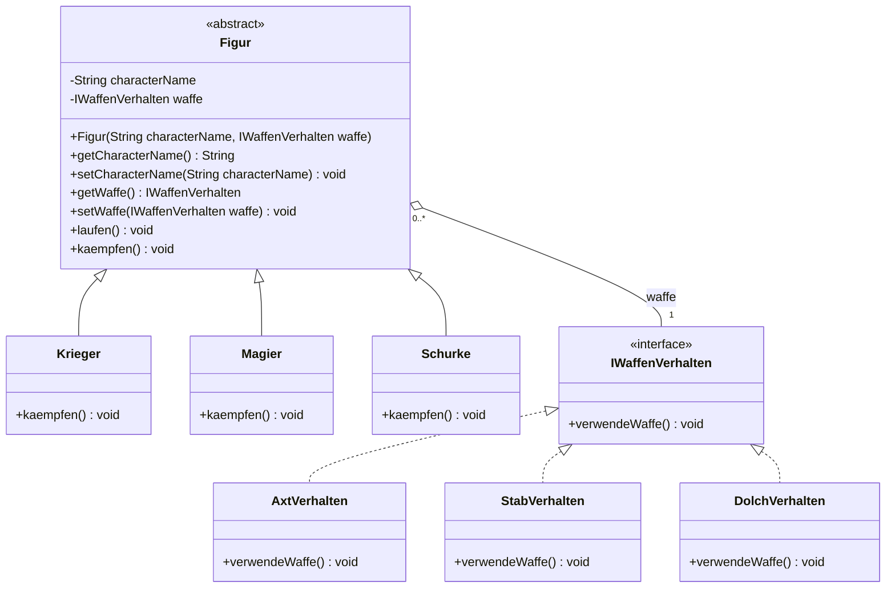
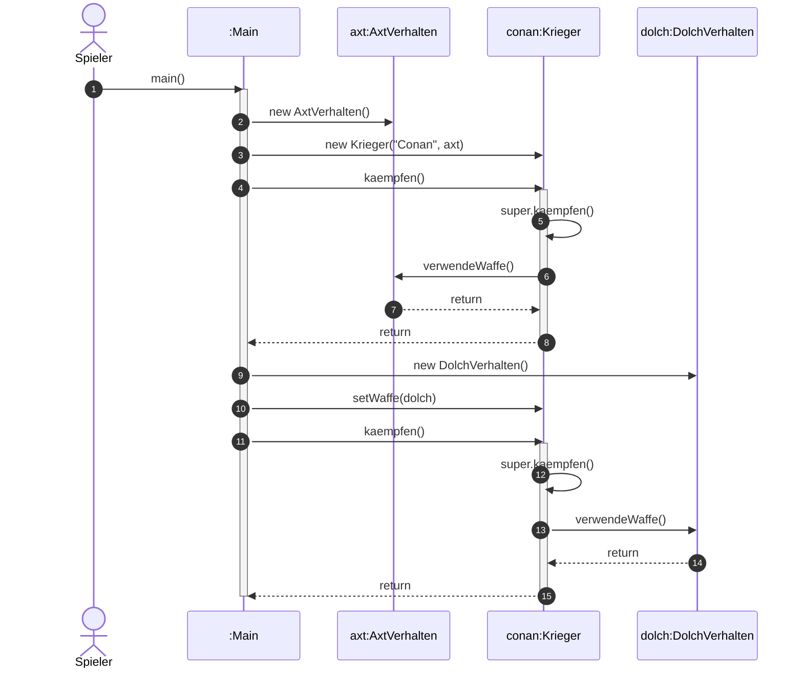

# M3 Serie A – Interfaces im UML-Klassendiagramm & Sequenzdiagramm

Grundlage ist der Code aus **V3 Serie B** (`../V3_SerieB`).
Die Diagramme liegen als PlantUML (`klassendiagramm.puml`, `sequenzdiagramm.puml`)
und unten als Mermaid vor (wird direkt auf GitHub gerendert).
Rendern der PlantUML-Dateien z.B. mit <https://www.plantuml.com/plantuml> oder dem
PlantUML-Plugin in IntelliJ / VS Code.

## Notation: Interface vs. Vererbung

| Beziehung | Bedeutung | Notation |
|---|---|---|
| **Vererbung** (IST) | `Krieger extends Figur` | durchgezogene Linie, leeres Dreieck zur Superklasse |
| **Realisierung** (Interface) | `AxtVerhalten implements IWaffenVerhalten` | **gestrichelte** Linie, leeres Dreieck zum Interface |
| **Aggregation** (HAT) | `Figur` hat ein `IWaffenVerhalten` | Linie mit **leerer Raute** beim Ganzen (Figur), Kardinalitäten an beiden Enden |
| Interface | `IWaffenVerhalten` | Stereotyp `<<interface>>`, nur Methoden |
| abstrakte Klasse | `Figur` | Name *kursiv* bzw. `{abstract}` |

Kardinalitäten: Eine Figur hat genau **1** Waffen-Verhalten; ein Waffen-Verhalten
kann von **0..\*** Figuren verwendet werden.

## a) Klassendiagramm

## b) Sequenzdiagramm – Use Case „Krieger kämpft und wechselt die Waffe“

Abgeleitet aus `Main.main()` in V3: Ein Krieger wird mit einer Axt erzeugt,
kämpft, bekommt zur Laufzeit einen Dolch und kämpft erneut.
Man sieht schön, dass `kaempfen()` an das jeweils gesetzte Waffen-Objekt delegiert.

