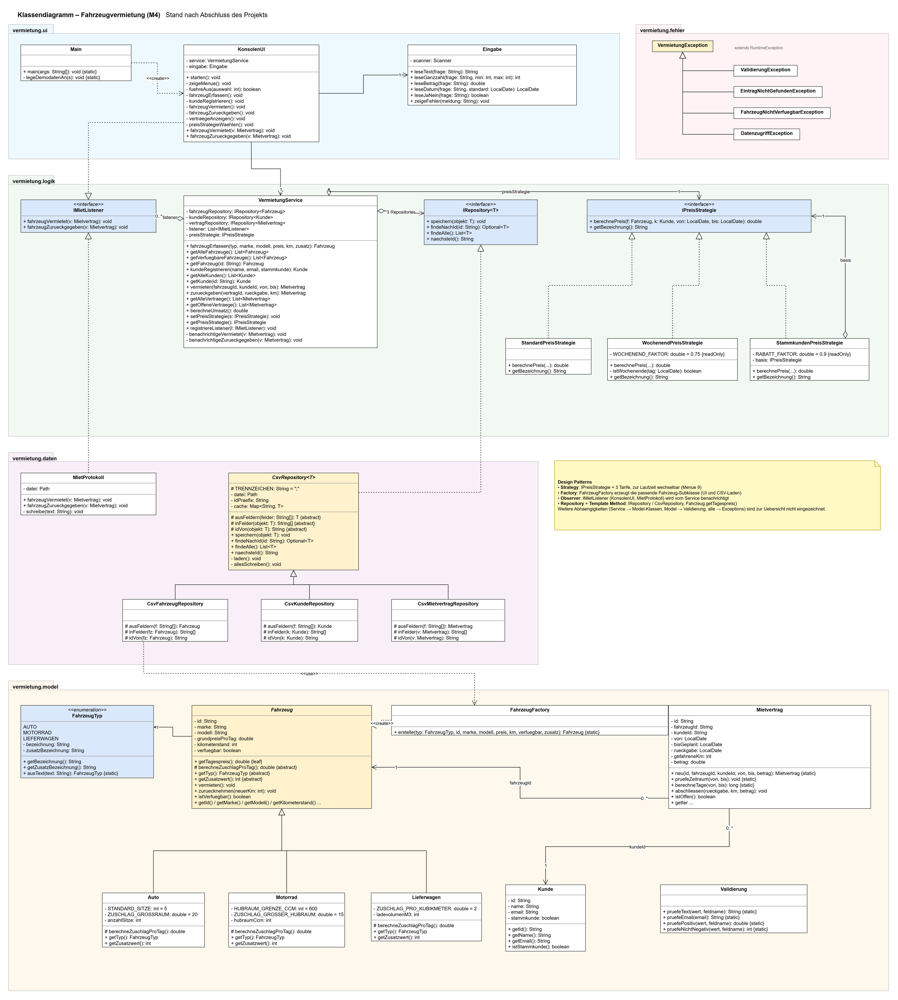
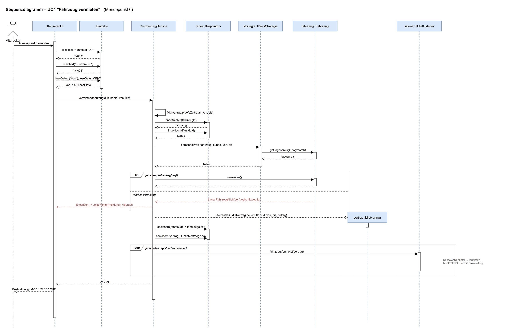

# M4 – Eigenes Projekt: Fahrzeugvermietung

Kompetenznachweis M4 (Modul 320), Einzelarbeit.
Konsolen-Applikation in Java (JVM), ohne externe Bibliotheken. Diagramme mit **draw.io** (`diagramme/`).

## 1. Beschreibung der Applikation

Eine kleine Fahrzeugvermietung verwaltet ihre Autos, Motorräder und Lieferwagen.
Ein Mitarbeiter erfasst Fahrzeuge und Kunden, vermietet Fahrzeuge für einen Zeitraum und nimmt sie
wieder zurück. Der Mietpreis hängt vom **Fahrzeugtyp** ab (jeder Typ berechnet seinen Zuschlag selbst)
und vom gewählten **Tarif** (Standard, Wochenend-Aktion, Stammkundenrabatt). Alle Daten werden in
CSV-Dateien gespeichert und sind beim nächsten Start wieder da.

### Ziel (Muss-Kriterien)

- Fahrzeuge (Auto, Motorrad, Lieferwagen) erfassen und anzeigen, verfügbare Fahrzeuge filtern
- Kunden registrieren und anzeigen
- Fahrzeug an einen Kunden vermieten (Mietvertrag mit Zeitraum und voraussichtlichem Preis)
- Fahrzeug zurücknehmen (Kilometerstand, Endbetrag nach effektivem Rückgabedatum)
- Mietverträge und Umsatz anzeigen
- Preisstrategie zur Laufzeit wechseln
- Persistenz in Dateien, saubere Trennung UI / Logik / Daten
- Validierung aller Eingaben mit Exceptions und verständlichen Fehlermeldungen

### Nice-to-have

- Protokoll-Datei aller Vermietungen (Observer) ✔ umgesetzt
- Demodaten beim ersten Start ✔ umgesetzt
- Reservationen in der Zukunft mit Überschneidungsprüfung
- Fahrzeug / Kunde bearbeiten und löschen
- Grafische Oberfläche (JavaFX) oder REST-API (Spring Boot) auf derselben Logik-Schicht
- Speicherung in einer echten Datenbank (H2 / SQLite) statt CSV – nur ein neues `IRepository` nötig

## 2. Anforderungen

| Nr. | Anforderung |
|---|---|
| A1 | Objektorientiert, JVM (Java 21), mind. 8 eigene Klassen, mind. 800 Zeilen Code |
| A2 | Schichten getrennt: `ui` (Konsole), `logik` (Service, Strategien, Interfaces), `model` (Fachklassen), `daten` (CSV-Persistenz), `fehler` (Exceptions) |
| A3 | Daten bleiben zwischen Programmstarts erhalten (CSV-Dateien in `data/`) |
| A4 | Ungültige Eingaben (Text statt Zahl, falsches Datum, leere Felder, ungültige E-Mail, negativer Preis, Rückgabe vor Mietbeginn …) führen zu einer Fehlermeldung, nie zum Absturz |
| A5 | Vererbungshierarchie und Interfaces werden sinnvoll eingesetzt |
| A6 | Mindestens zwei Design Patterns sind im Code ersichtlich und begründet |
| A7 | Clean-Code-Regeln angewendet und im Code markiert (`// Clean Code:`) |
| A8 | KI-Unterstützung im Code deklariert, Prompts dokumentiert ([docs/KI-Prompts.md](docs/KI-Prompts.md)) |

## 3. Use Cases

Akteur: **Mitarbeiter** der Vermietung (bedient die Konsole).

| UC | Name | Ablauf (kurz) | Menü |
|---|---|---|---|
| UC1 | Fahrzeug erfassen | Typ wählen, Marke, Modell, Grundpreis, km-Stand und typ-spezifischen Wert (Sitze / Hubraum / Ladevolumen) eingeben → Fahrzeug erhält ID `F-xxx` | 3 |
| UC2 | Fahrzeuge anzeigen | Alle Fahrzeuge oder nur die verfügbaren mit Tagespreis anzeigen | 1, 2 |
| UC3 | Kunde registrieren / anzeigen | Name, E-Mail (eindeutig), Stammkunde j/n → ID `K-xxx` | 4, 5 |
| UC4 | **Fahrzeug vermieten** | Fahrzeug-ID, Kunden-ID, Von/Bis eingeben → Preis wird mit aktueller Strategie berechnet, Fahrzeug als vermietet markiert, Mietvertrag `M-xxx` gespeichert, Listener benachrichtigt | 6 |
| UC5 | Fahrzeug zurückgeben | Offenen Vertrag wählen, Rückgabedatum und neuen km-Stand eingeben → Endbetrag berechnet, Fahrzeug wieder verfügbar | 7 |
| UC6 | Mietverträge & Umsatz anzeigen | Liste aller Verträge (offen / abgeschlossen) und Summe der abgeschlossenen | 8 |
| UC7 | Preisstrategie wählen | Standard, Wochenend-Aktion, jeweils optional mit Stammkundenrabatt | 9 |

## 4. Planung (Skizzen)

### Grobes Klassendiagramm

Hierarchie: `Fahrzeug` (abstrakt) → `Auto`, `Motorrad`, `Lieferwagen`.
Interfaces: `IPreisStrategie` (Tarife), `IRepository<T>` (Speicher), `IMietListener` (Benachrichtigung).


Quelle: [`diagramme/skizze_klassendiagramm.drawio`](diagramme/skizze_klassendiagramm.drawio)

### Grobes Sequenzdiagramm – UC4 Fahrzeug vermieten


Quelle: [`diagramme/skizze_sequenzdiagramm.drawio`](diagramme/skizze_sequenzdiagramm.drawio)

---

## 5. Umsetzung

### Starten

Voraussetzung: Java 17+ (getestet mit Java 21). Im Ordner `M4_Projekt`:

```bash
javac -d out $(find src -name "*.java")     # PowerShell: javac -d out (Get-ChildItem -Recurse src -Filter *.java).FullName
java -cp out vermietung.Main                # Daten in ./data (optional: anderer Ordner als Argument)
java -cp out vermietung.SelbstTest          # 17 Pruefungen, ohne JUnit
```

Beim ersten Start werden Demodaten angelegt (4 Fahrzeuge, 2 Kunden). Die Daten liegen danach in
`data/fahrzeuge.csv`, `data/kunden.csv`, `data/mietvertraege.csv` und `data/protokoll.log`.

### Aufbau (Schichten)

| Paket | Inhalt | Klassen |
|---|---|---|
| `vermietung.ui` | Konsole: Menü, Eingaben lesen, Ausgaben | `KonsolenUI`, `Eingabe` |
| `vermietung.logik` | Geschäftsregeln und die Interfaces, die die Logik braucht | `VermietungService`, `IPreisStrategie` + 3 Tarife, `IRepository<T>`, `IMietListener` |
| `vermietung.model` | Fachklassen und deren Regeln | `Fahrzeug` → `Auto`, `Motorrad`, `Lieferwagen`, `FahrzeugTyp`, `FahrzeugFactory`, `Kunde`, `Mietvertrag`, `Validierung` |
| `vermietung.daten` | Persistenz in CSV-Dateien | `CsvRepository<T>` → 3 Repositories, `MietProtokoll` |
| `vermietung.fehler` | eigene Exceptions | `VermietungException` → 4 Subklassen |

Umfang: 30 Java-Dateien, ca. 1600 Zeilen. Die Logik kennt weder `System.out` noch Dateien:
sie spricht nur über die Interfaces `IRepository` und `IMietListener` mit der Aussenwelt.

### Vererbung

- **`Fahrzeug` (abstrakt) → `Auto`, `Motorrad`, `Lieferwagen`**: Gemeinsame Daten (ID, Marke, km-Stand,
  Verfügbarkeit) und Verhalten (`vermieten()`, `zuruecknehmen()`) stehen einmal in der Superklasse.
  Jede Subklasse liefert ihren Zuschlag über `berechneZuschlagProTag()` (Polymorphismus): Auto mit mehr als
  5 Sitzen +20 CHF, Motorrad ab 600 ccm +15 CHF, Lieferwagen 2 CHF pro m³.
  `getTagespreis()` ist `final` und ruft den Zuschlag auf (Template Method).
- **`CsvRepository<T>` (abstrakt) → 3 Repositories**: Laden, Schreiben, Cache und ID-Vergabe sind gemeinsam,
  die Subklassen kennen nur ihr CSV-Format.
- **`VermietungException` → 4 Subklassen**: Die UI fängt alle fachlichen Fehler mit einem einzigen `catch` ab.

### Interfaces

| Interface | Implementiert von | Zweck |
|---|---|---|
| `IPreisStrategie` | `StandardPreisStrategie`, `WochenendPreisStrategie`, `StammkundenPreisStrategie` | austauschbare Preisberechnung |
| `IRepository<T>` | `CsvRepository<T>` (und damit alle CSV-Repositories) | Speicher austauschbar (CSV → DB) |
| `IMietListener` | `KonsolenUI`, `MietProtokoll` | Benachrichtigung bei Vermietung / Rückgabe |

### Delegation und Polymorphismus

- `VermietungService` **delegiert** die Preisberechnung an `IPreisStrategie`, das Speichern an `IRepository`
  und Meldungen an `IMietListener`.
- `StammkundenPreisStrategie` **delegiert** an eine Basis-Strategie und rechnet nur den Rabatt dazu
  (Komposition statt einer weiteren Vererbungsstufe).
- `KonsolenUI` delegiert das Einlesen und Prüfen der Eingaben an `Eingabe`.
- Polymorph aufgerufen werden `fahrzeug.getTagespreis()`, `strategie.berechnePreis(...)`,
  `listener.fahrzeugVermietet(...)` und `repository.speichern(...)`. Der Aufrufer kennt die konkrete Klasse nie.

## 6. Design Patterns

| Pattern | Wo | Warum es hier Sinn macht |
|---|---|---|
| **Strategy** | `IPreisStrategie` + `StandardPreisStrategie`, `WochenendPreisStrategie`, `StammkundenPreisStrategie`; gesetzt mit `VermietungService.setPreisStrategie()`, gewählt in Menü 9 | Tarife ändern sich häufig (Aktionen, Rabatte). Ohne Strategy stünde im Service ein wachsendes `if/switch` über alle Tarife. So kommt ein neuer Tarif als neue Klasse dazu, der Service bleibt unverändert (Open/Closed), und der Tarif lässt sich zur Laufzeit wechseln. |
| **Factory** | `FahrzeugFactory.erstelle(typ, …)` | Fahrzeuge entstehen an zwei Stellen: beim Erfassen in der UI und beim Laden aus der CSV-Datei. Die Entscheidung „welcher Typ → welche Subklasse“ steht nur einmal in der Factory statt doppelt. Ein neuer Fahrzeugtyp braucht nur einen neuen Enum-Wert und einen `case`. |
| **Observer** | `IMietListener`; Subjekt `VermietungService` (`registriereListener`, `benachrichtige…`); Beobachter `KonsolenUI`, `MietProtokoll` | Nach einer Vermietung sollen mehrere, voneinander unabhängige Dinge passieren (Konsolenmeldung, Protokolldatei, später z.B. E-Mail). Der Service muss diese Empfänger nicht kennen; sie werden in `Main` registriert. |
| Repository | `IRepository<T>`, `CsvRepository<T>` | Trennt Logik und Persistenz; ein Wechsel auf eine Datenbank braucht nur eine neue Implementierung. |
| Template Method | `Fahrzeug.getTagespreis()` / `berechneZuschlagProTag()`, `CsvRepository.laden()` / `ausFeldern()` | Fester Ablauf in der Superklasse, variabler Schritt in der Subklasse. |

## 7. Validierung und Exception Handling

- **Formale Prüfung in der UI** (`Eingabe`): Zahlen, Beträge (auch mit Komma), Datum `TT.MM.JJJJ`, j/n.
  Bei Fehleingabe wird die Frage wiederholt (`NumberFormatException` und `DateTimeParseException` werden abgefangen).
- **Fachliche Prüfung in Model/Logik** (`Validierung`, Konstruktoren, `VermietungService`): leere Texte, `;` im Text
  (CSV-Trennzeichen), E-Mail-Format und Eindeutigkeit, Preis > 0, Sitze/Hubraum/Ladevolumen im gültigen Bereich,
  Enddatum vor Startdatum, sinkender km-Stand, Fahrzeug bereits vermietet, unbekannte ID.
  All diese Fälle werfen eine Subklasse von `VermietungException`.
- **Zentral abgefangen** in `KonsolenUI.starten()`: Meldung anzeigen, Menü erneut anzeigen. Die Applikation stürzt nicht ab.
- **Datenfehler**: `IOException` und defekte CSV-Zeilen werden in eine `DatenzugriffException` verpackt (mit Zeilennummer).

## 8. Clean Code – wo im Code

Im Code mit `// Clean Code:` bzw. im Klassenkommentar markiert:

| Regel | Stelle |
|---|---|
| Single Responsibility | `logik/VermietungService.java` (nur Geschäftsregeln), Schichtentrennung allgemein |
| Dependency Injection / Dependency Inversion | Konstruktor in `logik/VermietungService.java`; `logik/IRepository.java` |
| DRY | `model/Validierung.java` (jede Prüfregel genau einmal), `model/FahrzeugFactory.java` |
| Keine Magic Numbers | `model/Auto.java`, `Motorrad.java`, `Lieferwagen.java`, `logik/WochenendPreisStrategie.java` (benannte Konstanten) |
| Kleine Methoden, sprechende Namen | `ui/KonsolenUI.java` (`fuehreAus` → eine Methode pro Menüpunkt), `WochenendPreisStrategie.istWochenende()` |
| Fehlerbehandlung an einer Stelle | `ui/KonsolenUI.java`, Methode `starten()` |
| Unveränderlichkeit | `final`-Felder in `Kunde` und `Fahrzeug` (ID, Marke, Preis), `List.copyOf` in `CsvRepository.findeAlle()` |

## 9. Klassendiagramm (nach Abschluss)



Quelle (draw.io): [`diagramme/klassendiagramm.drawio`](diagramme/klassendiagramm.drawio)

Gegenüber der Skizze dazugekommen: `Eingabe` (Eingabeprüfung aus der UI ausgelagert), `StammkundenPreisStrategie`
(Rabatt per Delegation statt kopierter Tarife), `FahrzeugTyp`-Enum, `Validierung`, die Exception-Hierarchie
und `KonsolenUI` als zweiter Observer.

## 10. Sequenzdiagramm – UC4 Fahrzeug vermieten



Quelle (draw.io): [`diagramme/sequenzdiagramm_vermieten.drawio`](diagramme/sequenzdiagramm_vermieten.drawio)

Die Prompts, mit denen die Diagramme erzeugt wurden, stehen in [docs/KI-Prompts.md](docs/KI-Prompts.md).

## 11. Umgesetzte Use Cases / Demo-Ablauf

Alle Use Cases UC1–UC7 sind umgesetzt. Vorschlag für die Demonstration:

1. Start → Demodaten werden angelegt. **UC2**: Menü 1 und 2.
2. **UC1**: Menü 3, ein Auto erfassen; dabei einmal `abc` als Preis eingeben → Fehlermeldung, die Frage wird wiederholt.
3. **UC3**: Menü 5, Kunde mit ungültiger E-Mail → Fehlermeldung; danach korrekt registrieren.
4. **UC4**: Menü 6, `F-003` an `K-001` von Freitag bis Montag → Mietvertrag `M-001` und `[Info]`-Meldung (Observer).
   Dasselbe Fahrzeug nochmals vermieten → „Fahrzeug F-003 ist bereits vermietet.“
5. **UC7**: Menü 9 → Wochenend-Aktion wählen.
6. **UC5**: Menü 7, `M-001` zurückgeben, zuerst einen kleineren km-Stand eingeben → Fehler; dann korrekt → Endbetrag mit Wochenendrabatt.
7. **UC6**: Menü 8 → Vertrag und Umsatz. Programm beenden und neu starten → die Daten sind noch da; `data/protokoll.log` zeigen.

## 12. Fazit und Lernprozess

- **Planung zahlt sich aus:** Die Skizze mit den drei Interfaces hat bis zum Schluss gehalten. Was dazukam
  (Eingabe, Validierung, Exceptions), war Detailarbeit und keine Umstrukturierung.
- **Interfaces gehören in die Logik-Schicht:** Liegt `IRepository` bei den CSV-Klassen, hängt die Logik von der
  Daten-Schicht ab. Liegt das Interface in `logik` und wird von `daten` implementiert, zeigen alle Abhängigkeiten
  in dieselbe Richtung (Dependency Inversion).
- **Strategy + Delegation statt Vererbung:** Für „Wochenende + Stammkunde“ hätte es mit Vererbung eine weitere
  Subklasse gebraucht. Mit einer Strategie, die an eine andere delegiert, lassen sich die Tarife frei kombinieren.
- **Validierung an zwei Orten:** Die UI prüft nur das Format (ist es eine Zahl?), das Modell die Fachregeln
  (ist der Preis positiv?). So gelten die Regeln auch beim Laden aus der CSV-Datei und im Selbsttest.
- **KI-Unterstützung:** Die KI hat beim Gerüst, beim Code und beim Erzeugen der draw.io-Diagramme geholfen.
  Wichtig war, jede Regel nachzurechnen, alle Use Cases selbst durchzuspielen und die Diagramme gegen den
  Code zu prüfen. Die Diagramme wurden in mehreren Runden korrigiert (überlappende Boxen, Kantenführung).
- **Nächste Schritte:** Reservationen mit Überschneidungsprüfung, Datenbank statt CSV, eine GUI auf derselben
  Logik-Schicht.
