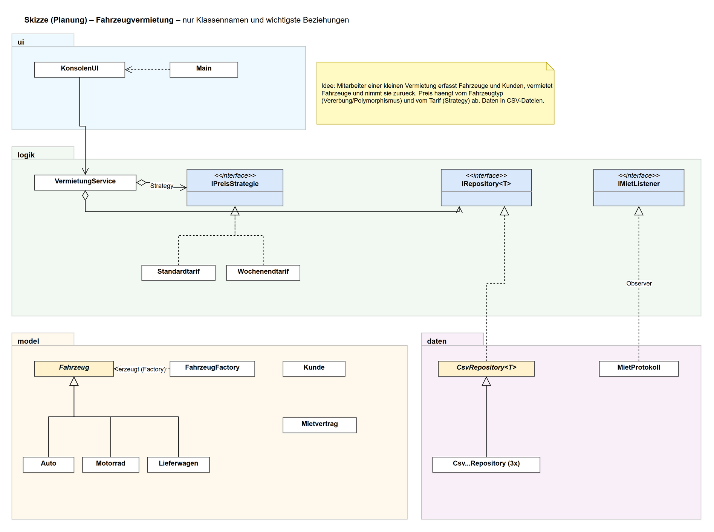
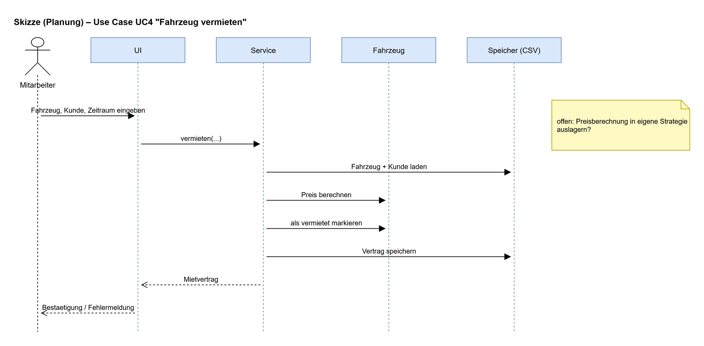

# M4 – Eigenes Projekt: Fahrzeugvermietung

Kompetenznachweis M4 (Modul 320), Einzelarbeit.
Konsolen-Applikation in Java (JVM), ohne externe Bibliotheken. Diagramme mit **draw.io** (`diagramme/`).

## 1. Beschreibung der Applikation

Eine kleine Fahrzeugvermietung verwaltet ihre Autos, Motorräder und Lieferwagen.
Ein Mitarbeiter erfasst Fahrzeuge und Kunden, vermietet Fahrzeuge für einen Zeitraum und nimmt sie
wieder zurück. Der Mietpreis hängt vom **Fahrzeugtyp** ab (jeder Typ berechnet seinen Zuschlag selbst)
und vom gewählten **Tarif** (Standard, Wochenend-Aktion, Stammkundenrabatt). Alle Daten werden in
CSV-Dateien gespeichert und sind beim nächsten Start wieder da.

### Ziel (Muss-Kriterien)

- Fahrzeuge (Auto, Motorrad, Lieferwagen) erfassen und anzeigen, verfügbare Fahrzeuge filtern
- Kunden registrieren und anzeigen
- Fahrzeug an einen Kunden vermieten (Mietvertrag mit Zeitraum und voraussichtlichem Preis)
- Fahrzeug zurücknehmen (Kilometerstand, Endbetrag nach effektivem Rückgabedatum)
- Mietverträge und Umsatz anzeigen
- Preisstrategie zur Laufzeit wechseln
- Persistenz in Dateien, saubere Trennung UI / Logik / Daten
- Validierung aller Eingaben mit Exceptions und verständlichen Fehlermeldungen

### Nice-to-have

- Protokoll-Datei aller Vermietungen (Observer) ✔ umgesetzt
- Demodaten beim ersten Start ✔ umgesetzt
- Reservationen in der Zukunft mit Überschneidungsprüfung
- Fahrzeug / Kunde bearbeiten und löschen
- Grafische Oberfläche (JavaFX) oder REST-API (Spring Boot) auf derselben Logik-Schicht
- Speicherung in einer echten Datenbank (H2 / SQLite) statt CSV – nur ein neues `IRepository` nötig

## 2. Anforderungen

| Nr. | Anforderung |
|---|---|
| A1 | Objektorientiert, JVM (Java 21), mind. 8 eigene Klassen, mind. 800 Zeilen Code |
| A2 | Schichten getrennt: `ui` (Konsole), `logik` (Service, Strategien, Interfaces), `model` (Fachklassen), `daten` (CSV-Persistenz), `fehler` (Exceptions) |
| A3 | Daten bleiben zwischen Programmstarts erhalten (CSV-Dateien in `data/`) |
| A4 | Ungültige Eingaben (Text statt Zahl, falsches Datum, leere Felder, ungültige E-Mail, negativer Preis, Rückgabe vor Mietbeginn …) führen zu einer Fehlermeldung, nie zum Absturz |
| A5 | Vererbungshierarchie und Interfaces werden sinnvoll eingesetzt |
| A6 | Mindestens zwei Design Patterns sind im Code ersichtlich und begründet |
| A7 | Clean-Code-Regeln angewendet und im Code markiert (`// Clean Code:`) |
| A8 | KI-Unterstützung im Code deklariert, Prompts dokumentiert ([docs/KI-Prompts.md](docs/KI-Prompts.md)) |

## 3. Use Cases

Akteur: **Mitarbeiter** der Vermietung (bedient die Konsole).

| UC | Name | Ablauf (kurz) | Menü |
|---|---|---|---|
| UC1 | Fahrzeug erfassen | Typ wählen, Marke, Modell, Grundpreis, km-Stand und typ-spezifischen Wert (Sitze / Hubraum / Ladevolumen) eingeben → Fahrzeug erhält ID `F-xxx` | 3 |
| UC2 | Fahrzeuge anzeigen | Alle Fahrzeuge oder nur die verfügbaren mit Tagespreis anzeigen | 1, 2 |
| UC3 | Kunde registrieren / anzeigen | Name, E-Mail (eindeutig), Stammkunde j/n → ID `K-xxx` | 4, 5 |
| UC4 | **Fahrzeug vermieten** | Fahrzeug-ID, Kunden-ID, Von/Bis eingeben → Preis wird mit aktueller Strategie berechnet, Fahrzeug als vermietet markiert, Mietvertrag `M-xxx` gespeichert, Listener benachrichtigt | 6 |
| UC5 | Fahrzeug zurückgeben | Offenen Vertrag wählen, Rückgabedatum und neuen km-Stand eingeben → Endbetrag berechnet, Fahrzeug wieder verfügbar | 7 |
| UC6 | Mietverträge & Umsatz anzeigen | Liste aller Verträge (offen / abgeschlossen) und Summe der abgeschlossenen | 8 |
| UC7 | Preisstrategie wählen | Standard, Wochenend-Aktion, jeweils optional mit Stammkundenrabatt | 9 |

## 4. Planung (Skizzen)

### Grobes Klassendiagramm

Hierarchie: `Fahrzeug` (abstrakt) → `Auto`, `Motorrad`, `Lieferwagen`.
Interfaces: `IPreisStrategie` (Tarife), `IRepository<T>` (Speicher), `IMietListener` (Benachrichtigung).

Quelle: [`diagramme/skizze_klassendiagramm.drawio`](diagramme/skizze_klassendiagramm.drawio)

### Grobes Sequenzdiagramm – UC4 Fahrzeug vermieten

Quelle: [`diagramme/skizze_sequenzdiagramm.drawio`](diagramme/skizze_sequenzdiagramm.drawio)
