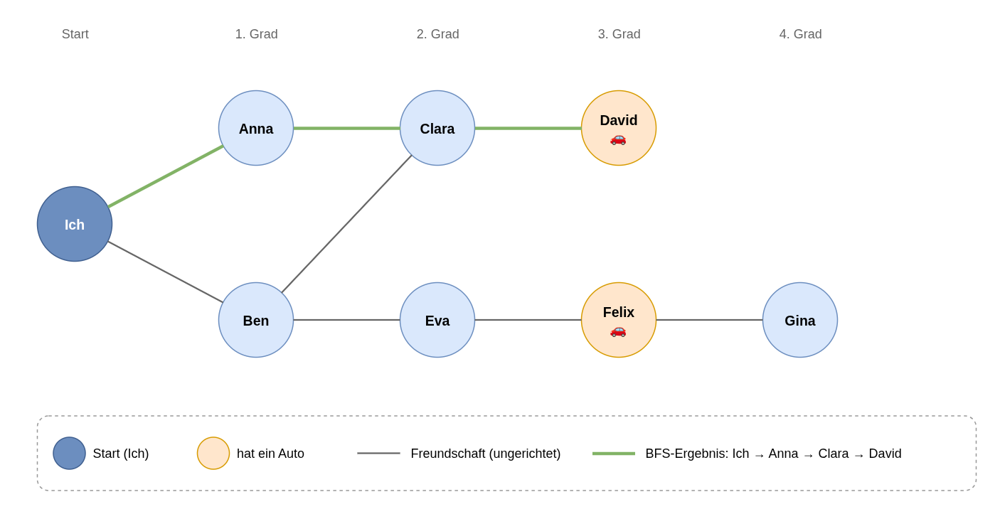

# Q3 Serie B – Graphen und Such-Algorithmus (BFS)

## Idee
Ein Graph wird als `HashMap<String, List<String>>` abgebildet:
**Key** = Knoten (Person), **Value** = Liste der Nachbarknoten (Freunde).
Der Wert ist also nicht ein Element, sondern wiederum eine **Liste**.

## Personen-Netzwerk (visuell)
Freundschaften sind gegenseitig (ungerichtet). Orange = Person besitzt ein Auto.

[](netzwerk.drawio)

Die grünen Kanten zeigen das Ergebnis der Breitensuche ab „Ich“.

## Breitensuche (Breadth-First-Search)
Frage: *Wer ist die nächste Person in meinem Netzwerk, die ein Auto hat?*

1. Alle Freunde von „Ich“ in eine **Queue** stellen.
2. Erste Person aus der Queue nehmen; schon geprüft? → überspringen.
3. Hat sie ein Auto? → gefunden, fertig.
4. Sonst: ihre Nachbarn hinten an die Queue anhängen, als geprüft markieren.
5. Wiederholen bis die Queue leer ist → niemand mit Auto.

Weil die Queue zuerst alle Freunde 1. Grades, dann 2. Grades usw. abarbeitet,
findet BFS immer die **nächste** Person (kürzester Weg in Anzahl Kanten).
Die `geprueft`-Menge verhindert Endlosschleifen bei Zyklen.

`kuerzesterWeg(start, ziel)` merkt sich zusätzlich pro Knoten den Vorgänger
und liefert so den ganzen Weg.

`Main` bildet ausserdem den Beispiel-Graphen (Knoten 1–6) vom Auftragsblatt ab.
Dieser Graph ist **gerichtet** (`fuegeKanteHinzu`), das Netzwerk oben ungerichtet (`fuegeFreundschaftHinzu`).

## Klassen

| Klasse | Verantwortung (genau eine) |
|---|---|
| `Netzwerk` | Daten des Graphen speichern und abfragen (Adjazenzliste, Auto-Besitzer) |
| `Breitensuche` | Suchalgorithmen auf einem Netzwerk (nächster Auto-Besitzer, kürzester Weg) |
| `Mobilitaet` | Enum `MIT_AUTO` / `OHNE_AUTO` |
| `BeispielNetzwerke` | Beispieldaten aufbauen (Graph vom Auftragsblatt, Freundes-Netzwerk) |
| `KonsolenAusgabe` | Ergebnisse auf der Konsole ausgeben (einzige Klasse mit `System.out`) |
| `NetzwerkDemo` | Ablauf der Demo: Daten holen, Suche aufrufen, Ausgabe aufrufen |
| `Main` | nur Einstiegspunkt: `new NetzwerkDemo(new KonsolenAusgabe()).starten();` |

```
Main ──> NetzwerkDemo ──> BeispielNetzwerke   (Daten)
                     ├──> Breitensuche ──> Netzwerk   (Logik)
                     └──> KonsolenAusgabe   (Ausgabe)
```

## Clean Code – wo angewendet

Die Ausgabe des Programms ist vor und nach dem Refactoring identisch.

### 1. Naming Conventions – Namen erklären sich selbst

| Vorher | Nachher | Wo |
|---|---|---|
| `graph` (Map) | `nachbarnProPerson` – sagt, was drin ist | `Netzwerk.java:17` |
| `addFreundschaft(String a, String b)` | `fuegeFreundschaftHinzu(String person, String freund)` | `Netzwerk.java:47` |
| `addPerson`, `addKante` (Englisch/Deutsch gemischt) | `fuegePersonHinzu`, `fuegeKanteHinzu` (einheitlich Deutsch) | `Netzwerk.java:20, 24, 35` |
| `queue` | `warteschlange` | `Breitensuche.java:32, 72` |
| `for (String k = ziel; …)` | `for (String person = ziel; …)` | `Breitensuche.java:91` |
| `Map.Entry e` | Schleife über `person` | `KonsolenAusgabe.java:26` |
| `print()` | `zeigeAdjazenzliste(…)` – sagt, *was* gezeigt wird | `KonsolenAusgabe.java:25` |
| `addPerson("David", true)` – was heisst `true`? | `fuegePersonHinzu("David", MIT_AUTO)` | `BeispielNetzwerke.java:56, 58` |

### 2. Hard Coding – Konstanten und Enums statt Literale

- **Enum statt boolean-Literal:** `Mobilitaet.MIT_AUTO / OHNE_AUTO` (`Mobilitaet.java:7`), verwendet in
  `Netzwerk.fuegePersonHinzu` (`Netzwerk.java:24–28`) und `BeispielNetzwerke.fuegePersonenHinzu` (`BeispielNetzwerke.java:51–60`).
- **Konstanten statt mehrfach vorkommender Literale:** `START_PERSON` („Ich“ kam vorher 4× vor),
  `ENTFERNTESTE_PERSON`, `BEISPIEL_START`, `BEISPIEL_ZIEL` (`BeispielNetzwerke.java:11–14`) sowie
  `AUTO_MARKIERUNG`, `KEIN_TREFFER` (`KonsolenAusgabe.java:11–12`).
- **Daten als Tabelle statt 14 kopierter Aufrufe:** `BEISPIEL_KANTEN` und `FREUNDSCHAFTEN` (`BeispielNetzwerke.java:16, 20`),
  abgearbeitet in einer Schleife (`BeispielNetzwerke.java:33, 45`).

### 3. Kommentare – JavaDoc für die Spezifikation, Blockkommentar nur bei Komplexem

- **JavaDoc** für jede Klasse (`Netzwerk.java:11`, `Breitensuche.java:13`, `BeispielNetzwerke.java:6`, `KonsolenAusgabe.java:6`,
  `NetzwerkDemo.java:11`, `Main.java:3`, `Mobilitaet.java:3`)
  und für die nicht-trivialen öffentlichen Methoden: `fuegeKanteHinzu` (`Netzwerk.java:31`),
  `fuegeFreundschaftHinzu` (`Netzwerk.java:44`), `sucheNaechstenAutoBesitzer` (`Breitensuche.java:26`),
  `kuerzesterWeg` (`Breitensuche.java:48`). Beschrieben wird *was* passiert und was zurückkommt (Spezifikation),
  nicht *wie*.
- **Blockkommentar** nur bei der komplexesten Stelle: `berechneVorgaenger` (`Breitensuche.java:64`) erklärt den Trick
  mit `null` als Vorgänger der Startperson.
- **Keine Kommentare** bei Gettern / einfachen Methoden: `getNachbarn`, `getPersonen`, `hatAuto`, `enthaelt`.

### 4. Klassen – Single Responsibility Principle (SRP)

Vorher hatte `Netzwerk` drei Gründe für eine Änderung: Datenhaltung, Suchalgorithmus und Konsolenausgabe.
Nachher:

- `Netzwerk` (`Netzwerk.java:15`) speichert nur noch Daten.
- `Breitensuche` (`Breitensuche.java:18`) enthält nur die Algorithmen. Neue Klasse.
- **Auslagerungen aus `Main`:** Vorher stand alles in `main` (Daten aufbauen, suchen, ausgeben). Jetzt:
  - `BeispielNetzwerke` baut die Daten auf (`BeispielNetzwerke.java:31, 42`).
  - `KonsolenAusgabe` macht die Ausgabe, auch das frühere `print` aus `Netzwerk` (`KonsolenAusgabe.java:25`).
  - `NetzwerkDemo` steuert nur noch den Ablauf und delegiert (`NetzwerkDemo.java:23`).
  - `Main` startet nur noch (`Main.java:8–10`).
  Muss man die Ausgabe ändern (z. B. GUI statt Konsole), ändert sich nur `KonsolenAusgabe`; neue Testdaten
  betreffen nur `BeispielNetzwerke`.
- `getNachbarn` / `getPersonen` geben unveränderliche Sichten zurück (`Netzwerk.java:57, 61`), damit niemand
  von aussen die Daten verändert, ohne über `Netzwerk` zu gehen.

### 5. Methoden – kurz, eine Aufgabe, höchstens zwei Einrückungsebenen

- `kuerzesterWeg` (vorher 28 Zeilen mit 3 Ebenen) ist aufgeteilt in `kuerzesterWeg` (`Breitensuche.java:53`),
  `berechneVorgaenger` (`:69`), `merkeUnbesuchteNachbarn` (`:80`) und `baueWeg` (`:89`). Jede Methode macht genau eins.
- `sucheNaechstenAutoBesitzer`: verschachteltes `if` durch frühes `continue` ersetzt (`Breitensuche.java:37–39`),
  so bleiben es höchstens zwei Ebenen.
- `main` hatte vorher 42 Zeilen, jetzt 1 (`Main.java:9`). Die Arbeit steckt in kurzen Methoden mit je einer
  Aufgabe: `starten`, `zeigeBeispielGraph`, `zeigePersonenNetzwerk`, `zeigeAutoSuche` (`NetzwerkDemo.java`),
  `erstelleBeispielGraph`, `erstelleFreundesNetzwerk`, `fuegePersonenHinzu` (`BeispielNetzwerke.java`),
  `zeigeAdjazenzliste`, `zeigeKuerzestenWeg`, `zeigeAutoBesitzer`, `zeigeWegDorthin` (`KonsolenAusgabe.java`).
- **Kein `null` als Rückgabe:** `sucheNaechstenAutoBesitzer` liefert `Optional<String>` statt `null`
  (`Breitensuche.java:31`). Der Aufrufer muss den Fall „niemand gefunden“ behandeln (`NetzwerkDemo.java:46–48`, `KonsolenAusgabe.java:36`).

## Ausgabe (Auszug)
```
Kuerzester Weg 1 -> 6: [1, 2, 4, 5, 6]
Naechste Person mit Auto (BFS ab 'Ich'): David
Weg dorthin: [Ich, Anna, Clara, David]
Kuerzester Weg Ich -> Gina: [Ich, Ben, Eva, Felix, Gina]
```

## Ausführen
```bash
javac -d out src/graph/*.java
java -cp out graph.Main
```
