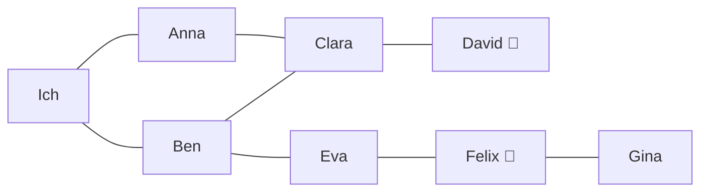

# Q3 Serie B – Graphen und Such-Algorithmus (BFS)

## Idee
Ein Graph wird als `HashMap<String, List<String>>` abgebildet:
**Key** = Knoten (Person), **Value** = Liste der Nachbarknoten (Freunde).
Der Wert ist also nicht ein Element, sondern wiederum eine **Liste**.

## Personen-Netzwerk (visuell)
Freundschaften sind gegenseitig (ungerichtet). `[Auto]` = Person besitzt ein Auto.



## Breitensuche (Breadth-First-Search)
Frage: *Wer ist die nächste Person in meinem Netzwerk, die ein Auto hat?*

1. Alle Freunde von „Ich“ in eine **Queue** stellen.
2. Erste Person aus der Queue nehmen; schon geprüft? → überspringen.
3. Hat sie ein Auto? → gefunden, fertig.
4. Sonst: ihre Nachbarn hinten an die Queue anhängen, als geprüft markieren.
5. Wiederholen bis die Queue leer ist → niemand mit Auto.

Weil die Queue zuerst alle Freunde 1. Grades, dann 2. Grades usw. abarbeitet,
findet BFS immer die **nächste** Person (kürzester Weg in Anzahl Kanten).
Die `geprueft`-Menge verhindert Endlosschleifen bei Zyklen.

`kuerzesterWeg(start, ziel)` merkt sich zusätzlich pro Knoten den Vorgänger
und liefert so den ganzen Weg.

`Main` bildet ausserdem den Beispiel-Graphen (Knoten 1–6) vom Auftragsblatt ab.

## Ausgabe (Auszug)
```
Naechste Person mit Auto (BFS ab 'Ich'): David
Weg dorthin: [Ich, Anna, Clara, David]
Kuerzester Weg Ich -> Gina: [Ich, Ben, Eva, Felix, Gina]
```

## Ausführen
```bash
javac -d out src/graph/*.java
java -cp out graph.Main
```
