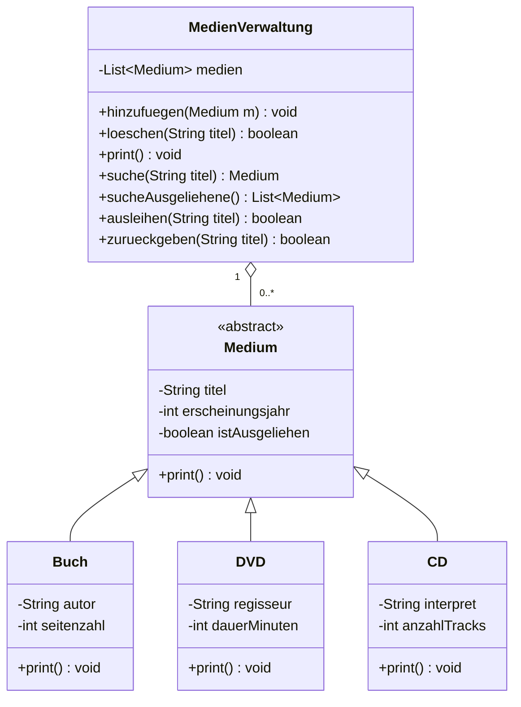

# V2 Serie A – Methoden überschreiben (Medien-Verwaltung)

## Klassen
| Klasse | Attribute |
|---|---|
| `Medium` (abstrakt, Superklasse) | `titel`, `erscheinungsjahr`, `istAusgeliehen` |
| `Buch` | + `autor`, `seitenzahl` |
| `DVD` | + `regisseur`, `dauerMinuten` |
| `CD` | + `interpret`, `anzahlTracks` |
| `MedienVerwaltung` | verwaltet `List<Medium>` |
| `Main` | User-Menu |

## Umsetzung
- Jede Subklasse überschreibt `print()` und gibt via `super.print()` auch die
  Attribute der Superklasse aus (Polymorphismus).
- `MedienVerwaltung`: `hinzufuegen()`, `loeschen()`, `print()` (ruft für jedes
  Medium dessen eigene `print()`-Methode auf), `suche(titel)`, `sucheAusgeliehene()`,
  `ausleihen()`, `zurueckgeben()`.
- **User-Interaktion**: Medien hinzufügen, nach ausgeliehenen Medien suchen,
  nur **nicht ausgeliehene** Medien löschen (`loeschen()` verweigert ausgeliehene).



## Ausführen
```bash
javac -d out src/medien/*.java
java -cp out medien.Main
```
