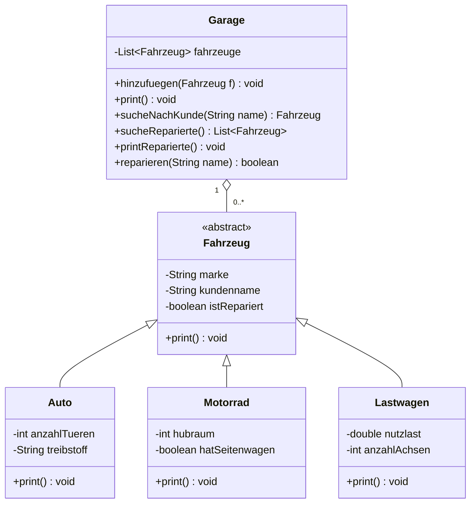

# V2 Serie C – Erweiterung der Garagen-App (Polymorphismus)

## Klassen
| Klasse | Attribute |
|---|---|
| `Fahrzeug` (abstrakt, Superklasse) | `marke`, `kundenname`, `istRepariert` |
| `Auto` | + `anzahlTueren`, `treibstoff` |
| `Motorrad` | + `hubraum` (ccm), `hatSeitenwagen` |
| `Lastwagen` | + `nutzlast` (t), `anzahlAchsen` |
| `Garage` | verwaltet `List<Fahrzeug>` |
| `Main` | User-Menu |

## Umsetzung
- Jede Subklasse **überschreibt** `print()` (`@Override`), ruft zuerst `super.print()`
  auf (Attribute der Superklasse) und gibt danach ihre eigenen Attribute aus.
- `Garage.print()` läuft über die `List<Fahrzeug>` und ruft bei jedem Objekt
  `print()` auf. Welche Methode ausgeführt wird, entscheidet sich erst zur Laufzeit
  anhand des echten Objekttyps → **Polymorphismus / dynamisches Binden**.
- `sucheNachKunde()` / `sucheUndPrint()` – ein bestimmtes Fahrzeug suchen und ausgeben.
- `sucheReparierte()` / `printReparierte()` – alle reparierten Fahrzeuge ausgeben.
- Menu: alle anzeigen, suchen, reparierte anzeigen, als repariert markieren.



## Ausführen
```bash
javac -d out src/garage/*.java
java -cp out garage.Main
```
